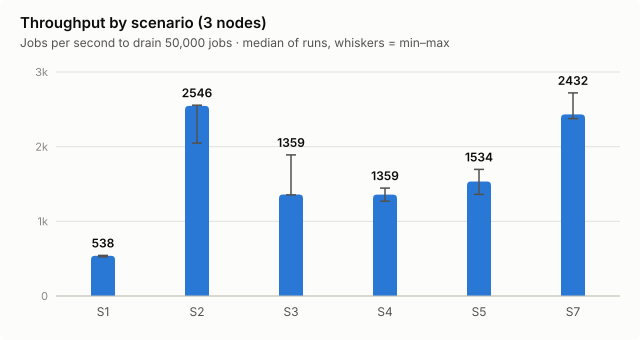
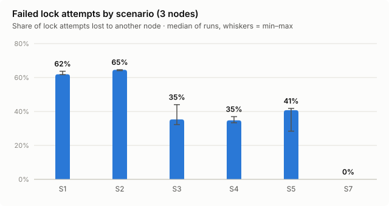
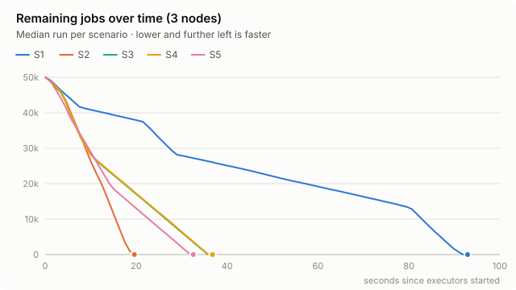
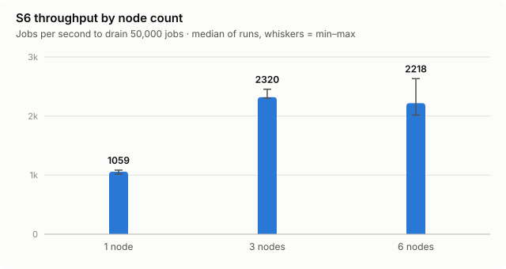
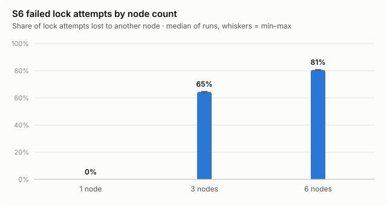
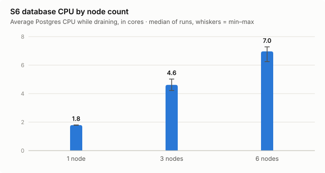

# Results: job acquisition in a Camunda cluster

Verification of [Scaling Camunda BPM in Cluster: Job Acquisition](https://camunda.com/blog/2015/09/scaling-camunda-bpm-in-cluster-job/) (Camunda blog, 2015)
on Camunda 7.8 / Spring Boot 1.5 / PostgreSQL 13. Plan and hypotheses: [PLAN.md](../PLAN.md). Runs on 2026-10-18.

## Verdict

| | Article's claim | Our result | Verdict |
|---|---|---|---|
| **H1** | Acquiring larger chunks (48 vs 3 jobs) is much faster | 48 jobs per acquisition drained 50,000 jobs **4.7× faster** (19.6 s vs 92.9 s) | **Confirmed** |
| **H2** | Backoff reduces failed locks but gives only a slight benefit | Backoff cut failed locks by **62–71%**, but made the drain **66–88% slower** | **Half confirmed**: fewer conflicts, but throughput got worse, not slightly better |
| **H3** | Adding nodes stops helping; the DB saturates | 1→3 nodes: **2.2×** faster. 3→6 nodes: **no gain**. DB used at most 9 of 24 cores | **Partly confirmed**: scaling stops, but not because of DB CPU (see caveats) |

The short version: **use large acquisition batches, and don't turn on backoff unless the database is the
bottleneck.** In this setup, backoff lets one node win most acquisitions while the others wait,
so a 3-node cluster performs like about one node.

## Setup

| | Article (2015) | This run |
|---|---|---|
| Camunda | 7.4.0-alpha1 | 7.8.0 (Spring Boot starter 2.3.0) |
| Database | PostgreSQL 9.4 on 2 cores | PostgreSQL 13, no CPU limit (24-core host) |
| Nodes | 3 (and up to 5) | 3 for S1–S5; 1, 3 and 6 for S6 |
| Workload | 50,000 instances, one async job each, 0–160 ms of work | Same (`benchmark.bpmn`, `BenchmarkDelegate`) |
| Executor threads | not stated | 90 core / 105 max per node |
| Other | — | acquire-by-priority on, history NONE, 768 MB heap per node, all containers on one host (WSL2) |

Each run starts from an empty database. All 50,000 jobs are created first, then every node's
job executor is started at the same moment, and the time until the job table is empty is measured.
Each configuration ran 3 times, interleaved (S1 S2 S3 S4 S5, ×3) so drift on the machine doesn't favour one scenario.
Values below are medians of the 3 runs, with min–max where shown.

## S1–S5: batch size and backoff (3 nodes)

| Scenario | maxJobs | Backoff (init/max/factor) | Drain time, s | Jobs/s | Failed locks | Failed share | Acquisition cycles | DB CPU, cores (avg / max) |
|---|---|---|---|---|---|---|---|---|
| S1 | 3 | off | 92.9 (91.9–95.5) | 538 | 81,379 | 62% | 43,871 | 2.7 / 3.3 |
| **S2** | **48** | **off** | **19.6 (19.6–24.4)** | **2,546** | 90,976 | 65% | 3,390 | 5.0 / 6.8 |
| S3 | 48 | 50/250/2 | 36.8 (26.5–36.9) | 1,359 | 27,312 | 35% | 2,889 | 2.5 / 7.2 |
| S4 | 48 | 70/350/2 | 36.8 (34.6–39.4) | 1,359 | 26,688 | 35% | 3,024 | 2.5 / 7.4 |
| S5 | 48 | 90/450/2 | 32.6 (29.5–36.8) | 1,534 | 34,400 | 41% | 2,975 | 2.6 / 5.8 |







*S3 and S4 overlap almost exactly in the chart above; both medians are 36.8 s.*

### H1: larger batches

S2 acquires up to 48 jobs per cycle instead of 3, and needs **13× fewer acquisition cycles**
(3,390 vs 43,871) for the same 50,000 jobs. The number of failed locks hardly changes
(about 81k vs 91k), but each cycle now delivers 16× more work, so the drain is 4.7× faster. Database CPU
doubles because the database is doing more useful work per second, not because of extra conflicts.

### H2: backoff

Backoff works as designed at the lock level: failed locks drop from about 91k to 27–34k, and the failed
share from 65% to 35–41%. But every backoff scenario is **slower** than S2. The per-node numbers show why:

| Scenario (median run) | Jobs executed per node | Acquisition cycles per node |
|---|---|---|
| S2 (no backoff) | 20,096 / 14,016 / 15,888 | 1,238 / 1,025 / 1,072 |
| S3 | 38,064 / 8,192 / 3,744 | 2,400 / 343 / 146 |
| S4 | 38,096 / 7,152 / 4,752 | 2,503 / 272 / 148 |
| S5 | 15,248 / 33,408 / 1,344 | 699 / 2,186 / 49 |

With backoff, the node that loses a few acquisitions backs off, so it loses the next race too, and
ends up waiting at maximum backoff while one node does 67–82% of all the work. That node then
runs at its own limit: from about 15 s into each backoff run, the job table drains at a steady
**~1,090 jobs/s**, which is exactly one node's thread capacity (90 threads ÷ ~82 ms per job).
A single node with no contention at all (S6, 1 node) reached 1,059 jobs/s. The two backoff runs where the work was
spread more evenly were also the fastest ones (top node 53% → 26.5 s, 58% → 29.5 s).

Why the article saw a small gain instead: its database had only 2 cores and reached 100% CPU (with 5 nodes),
so anything that reduced database load helped. Here the database never used more than about 7 of 24 cores,
so saving database work bought nothing, while idling two of three nodes cost a lot of capacity.

## S6: node scaling (48 per acquisition, no backoff)

| Nodes | Drain time, s | Jobs/s | Speed-up vs 1 node | Failed locks | Failed share | DB CPU, cores (avg / max) | All containers, cores (avg / max) |
|---|---|---|---|---|---|---|---|
| 1 | 47.2 (46.1–49.2) | 1,059 | 1.0× | 0 | 0% | 1.8 / 2.0 | 2.6 / 3.9 |
| 3 | 21.6 (20.4–21.7) | 2,320 | 2.2× | 90,880 | 65% | 4.6 / 7.0 | 8.6 / 17.3 |
| 6 | 22.5 (19.0–24.8) | 2,218 | 2.1× | 207,952 | 81% | 7.0 / 9.0 | 14.6 / 22.9 |







### H3: where scaling stops

Going from 1 to 3 nodes gives 2.2×, not 3×. Going from 3 to 6 gives nothing: the 6-node runs
(19.0–24.8 s) overlap the 3-node runs (20.4–21.7 s). The work is spread evenly across the 6 nodes
(6,032–13,152 jobs each), so this isn't the backoff problem. Instead, **81% of all lock attempts fail**:
every node runs the same acquisition query for the first 48 acquirable jobs, so they largely ask for
the same rows, and most lock attempts fail. Six nodes do 5,423 acquisition cycles in total, 60% more than three nodes
(3,416), to finish the same 50,000 jobs.

Unlike the article, the database CPU is **not** saturated: Postgres averaged 7 cores and peaked at
9 of 24. The limit here is contention on the same job rows, not database capacity.

## Caveats

- **Everything ran on one 24-core machine.** With 6 nodes, all containers together peaked at about
  23 of 24 cores (about 15 on average), so the host itself was close to its limit at the peaks. The 6-node result is
  partly a host limit, not only lock contention. Running the nodes on separate machines would separate the two.
- **Thread-bound nodes.** At 90 threads and about 82 ms per job, one node tops out at about 1,090 jobs/s. This
  makes losing a node to backoff very expensive, and is probably the biggest difference from the
  article's setup. Fewer threads per node, or a CPU-limited database (`DB_CPUS=2`), would move the
  bottleneck towards what the article measured. Both are one environment variable away in `bench/run.sh`.
- **Acquire-by-priority was on.** The article didn't use priorities. All benchmark jobs have priority 0,
  but the acquisition query still sorts by priority; the effect of that wasn't measured.
- **S2 had one slow run** (24.4 s vs 19.6 s twice) and S3 one fast run (26.5 s vs ~37 s twice).
  Medians are reported, so a single outlier doesn't move them, but 3 runs is a small sample.
- **Measurement resolution:** drain time is polled every second, and `docker stats` samples about
  every 1–2 s. With drains of 19–95 s, that's 1–5% uncertainty on the duration.

## Reproduce

```bash
bench/run-matrix.sh 3 S1 S2 S3 S4 S5                               # about 25 min
for n in 1 3 6; do NODES=$n SKIP_BUILD=1 bench/run.sh S6 1; done   # one round of S6
python3 bench/analyze.py > bench/results/tables.md                 # tables + charts/*.svg
```

Raw data per run is in `bench/results/<scenario>-n<nodes>-r<run>-<timestamp>/`
(config, progress, per-node metrics, docker stats), with one row per run in `bench/results/summary.csv`.
While a run is in progress, the Grafana dashboard at http://localhost:13000/d/camunda-bench shows the
article's acquired vs failed chart live.
