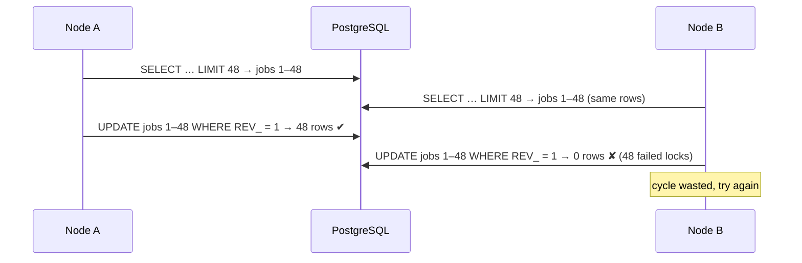
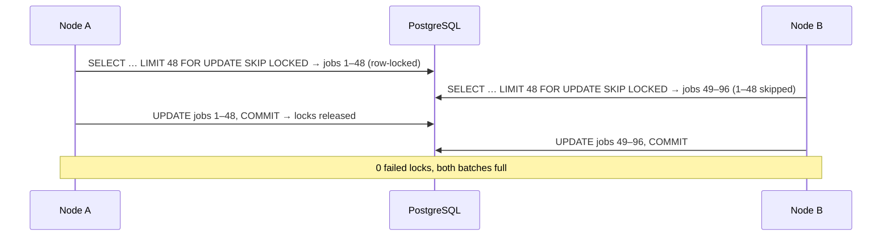
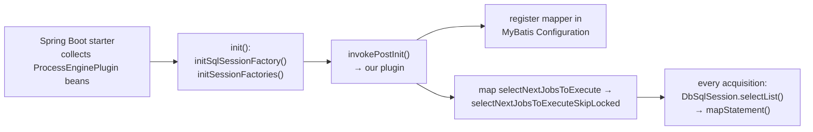

# SKIP LOCKED job acquisition for Camunda 7.8 on PostgreSQL

This project has an **opt-in** change to how the Camunda job executor acquires jobs. On PostgreSQL, the acquisition query
becomes `SELECT … FOR UPDATE SKIP LOCKED`, so nodes in a cluster stop competing for the same jobs. It is
built entirely from Camunda's and MyBatis's public extension points: **no Camunda source code is changed or forked.**

| | |
|---|---|
| Enable | `JOB_EXECUTOR_SKIP_LOCKED=true` (property `job-executor.acquisition-skip-locked`) |
| Code | [`SkipLockedJobAcquisitionPlugin.java`](../src/main/java/org/camunda/bpm/getstarted/config/SkipLockedJobAcquisitionPlugin.java), [`mappings/SkipLockedJobAcquisition.xml`](../src/main/resources/mappings/SkipLockedJobAcquisition.xml) |
| Requires | Camunda 7.8.0 (query copied from this version), PostgreSQL ≥ 9.5, READ COMMITTED isolation (Camunda's requirement anyway) |
| Benchmarks | [bench/RESULTS.md](../bench/RESULTS.md), scenarios S7 and S8 |

**In short:** in our benchmarks it removed all failed lock attempts (from 65–81%) and was 37–44% faster than every
backoff setting. Use it together with a large `maxJobsPerAcquisition`, not instead of it.

Contents:
1. [How Camunda 7.8 acquires jobs](#1-how-camunda-78-acquires-jobs)
2. [What the implementation changes](#2-what-the-implementation-changes)
3. [How this works without changing Camunda's source](#3-how-this-works-without-changing-camundas-source)
4. [Why it has no negative side effects on the engine](#4-why-it-has-no-negative-side-effects-on-the-engine)
5. [Is SKIP LOCKED a better alternative than backoff?](#5-is-skip-locked-a-better-alternative-than-backoff)
6. [Enabling, verifying and maintaining it](#6-enabling-verifying-and-maintaining-it)

Source references like `AcquireJobsCmd.java:56` point into `camunda-engine-7.8.0-sources.jar`.

---

## 1. How Camunda 7.8 acquires jobs

Each node runs one **acquisition thread** that repeatedly executes `AcquireJobsCmd`
(`SequentialJobAcquisitionRunnable.java:132-142`). The command runs in its own transaction: Camunda's
`commandExecutorTxRequired` uses Spring's `PROPAGATION_REQUIRED` (`SpringTransactionsProcessEngineConfiguration.java:75`),
and the acquisition thread has no surrounding transaction.

Inside that transaction, acquisition is **optimistic**:

1. **Select candidates, without locks.** `AcquireJobsCmd.java:56` calls `JobManager.findNextJobsToExecute`, which
   runs the MyBatis statement `selectNextJobsToExecute` (`JobManager.java:191`, `Job.xml:137-167`). On PostgreSQL it renders as:
   ```sql
   select RES.* from ACT_RU_JOB RES
   where RES.RETRIES_ > 0
     and (RES.DUEDATE_ is null or RES.DUEDATE_ <= ?)
     and (RES.LOCK_OWNER_ is null or RES.LOCK_EXP_TIME_ < ?)
     and RES.SUSPENSION_STATE_ = 1
     and (<exclusive job rules>)
   order by <priority / due date, as configured>
   LIMIT 48 OFFSET 0
   ```
2. **Lock in memory.** For each job, `lockJob` (`AcquireJobsCmd.java:91`) sets `LOCK_OWNER_` and `LOCK_EXP_TIME_` on the entity.
3. **Write at commit with a revision check.** On flush, each job becomes `update ACT_RU_JOB set … REV_ = REV_ + 1 where ID_ = ? and REV_ = ?`
   (`Job.xml:516`). If another node already locked that job, the revision no longer matches, the update hits 0 rows,
   and the engine reports an optimistic-locking failure.
4. **Drop the losers.** `AcquireJobsCmd` registers itself as an `OptimisticLockingListener` (`AcquireJobsCmd.java:85`).
   `failedOperation` removes each failed job from the batch (`AcquireJobsCmd.java:107-113`) and counts it in the
   `job-acquired-failure` metric.

Because step 1 takes no locks, **all nodes see the same head of the queue** and race for the same rows:



In our benchmarks, 62–65% of lock attempts failed with 3 nodes and 81% with 6 nodes.

## 2. What the implementation changes

Exactly one thing: the SQL text of `selectNextJobsToExecute`. The copy in
[`SkipLockedJobAcquisition.xml`](../src/main/resources/mappings/SkipLockedJobAcquisition.xml) is the 7.8.0 statement
unchanged (same parameters, WHERE clause, ordering, paging and result map), with one line added at the end:

```diff
     ${limitAfter}
+    FOR UPDATE OF RES SKIP LOCKED
```

- `FOR UPDATE OF RES` row-locks every job row the query returns, until the acquisition transaction ends.
- `SKIP LOCKED` makes the query skip rows another transaction currently has locked, instead of waiting for them.
  The `LIMIT` is applied after skipping, so a node still gets up to 48 *free* jobs.

The rest of acquisition is untouched: the same `lockJob`, the same revision-checked `UPDATE`, the same listener.
The UPDATE now always succeeds, because the node already holds the row lock:



The mapper also copies three small `<sql>` fragments from `Job.xml` (`AtomicExclusiveOrNonExclusiveJobs`,
`AtomicExclusiveJobs`, `NonExclusiveJobs`). In the engine, these fragments include each other by *relative* id, and
MyBatis resolves a relative id against the namespace of the mapper doing the including. So they can't be referenced
from another namespace. The copies are identical to the originals.

## 3. How this works without changing Camunda's source

The plugin uses four existing extension points, in this order:



1. **Plugin registration (Spring Boot starter).** `CamundaBpmConfiguration.processEngineConfigurationImpl(List<ProcessEnginePlugin>)`
   adds every `ProcessEnginePlugin` bean to the engine configuration. The plugin is a Spring `@Component`, with
   `@ConditionalOnProperty(job-executor.acquisition-skip-locked=true)` so that with the flag off it isn't even created.
2. **Timing (`ProcessEngineConfigurationImpl`).** `init()` builds the MyBatis `SqlSessionFactory` (line 760), then
   creates the `DbSqlSessionFactory` (line 762, created at line 1390), then calls the plugins' `postInit` (line 779).
   So at `postInit` both exist, all of Camunda's mappers are already parsed, and no command has run yet.
3. **Adding a statement (MyBatis).** MyBatis's `Configuration` accepts new mapped statements after it's built.
   The plugin parses the mapper with `XMLMapperBuilder` into the engine's own `Configuration`, sharing its SQL fragments
   and its variables. That's why `${prefix}`, `${limitAfter}`, `${orderBy}`, `${trueConstant}` and the `Commons.*`
   fragments resolve exactly as they do in Camunda's own mappers.
4. **Redirecting the statement (Camunda).** All Camunda selects go through `DbSqlSession.selectList`, which first calls
   `dbSqlSessionFactory.mapStatement(statement)` (`DbSqlSession.java:94`, `DbSqlSessionFactory.java:437`). This is how
   Camunda ships its own database-specific variants, such as `selectByteArray` → `selectByteArray_postgres`. The plugin
   copies the current mapping table (`getStatementMappings()`, line 476), adds
   `selectNextJobsToExecute → selectNextJobsToExecuteSkipLocked`, and installs the copy with `setStatementMappings()`
   (line 481). The copy matters: the original table is a static map shared by every engine.

`JobManager` keeps asking for `"selectNextJobsToExecute"` and gets the new SQL. No engine class is subclassed,
patched or replaced, and Camunda's own jar is used unmodified.

## 4. Why it has no negative side effects on the engine

The question is whether swapping that one query can change engine behaviour anywhere else. Point by point:

### 4.1 Scope: exactly one statement, called from one place

`selectNextJobsToExecute` has a single caller in the whole engine, `JobManager.findNextJobsToExecute` (`JobManager.java:191`),
and that method has a single caller, `AcquireJobsCmd` (`AcquireJobsCmd.java:56`). The statement mapping only
redirects that one id. Every other query, insert, update and delete goes to Camunda's original statements.
`ManagementService` job queries, the Cockpit/REST APIs, and job execution itself are not affected.

### 4.2 Same jobs, same order, same fields

The WHERE clause, the ordering (priority / due date / timers first, as configured), the paging, deployment-aware
filtering and the result map are all copied unchanged. The query can only return jobs the original query would
also return. The one difference is that it leaves out jobs another node is acquiring at that moment, which the
original would also have returned, only for this node to lose the race for them (§1).

### 4.3 The lock is the same, and failures disappear

After the SELECT, nothing changes: the same `lockJob`, the same `UPDATE … WHERE ID_ = ? AND REV_ = ?`, the same
`OptimisticLockingListener`. Since the node holds a row lock from the SELECT until commit, no other transaction can
change `REV_` in between, so the UPDATE can't fail. The listener stays registered but has nothing to do.
Revision checking stays in place as a safety net.

### 4.4 Locks are short and released by the engine's normal transaction end

The row locks live only inside the acquisition transaction: one SELECT plus one batch of UPDATEs, then commit.
In the benchmarks, that's milliseconds. The engine opens and commits this transaction the same way as before
(Spring `PROPAGATION_REQUIRED`), so no new transaction handling was added. If the node crashes or the
transaction rolls back, PostgreSQL releases the row locks immediately and the jobs stay unlocked in the table, ready for
any node. That's the same outcome as a failed acquisition today.

### 4.5 No blocking, no deadlocks from acquisition

- **The acquisition never waits.** `SKIP LOCKED` doesn't wait for locked rows, and the following UPDATEs only touch rows
  the transaction already holds. A transaction that never waits for a lock can't be part of a deadlock cycle.
- **Job execution is unaffected.** A job that's executing already has `LOCK_OWNER_` set, so the WHERE clause excludes it
  anyway. If an execution transaction happens to hold the row lock at that moment (while updating or deleting the job),
  `SKIP LOCKED` simply skips it.

### 4.6 Exclusive jobs: no change in guarantees

Camunda keeps exclusive jobs of one process instance apart with a `NOT EXISTS` subquery (`AtomicExclusiveJobs`). That
subquery reads a snapshot and takes no locks, both in the original and in the copy (`FOR UPDATE OF RES` locks only `RES`
rows). So two nodes can still pick up *different* exclusive jobs of the same instance at the same moment, exactly as
before. Camunda then handles it the same way, with optimistic locking on the execution when the jobs run. SKIP LOCKED
neither causes nor fixes this.

### 4.7 Lock expiry, retries, suspension, priorities: unchanged

These are all columns in the copied WHERE/ORDER BY clause (`LOCK_EXP_TIME_`, `RETRIES_`, `SUSPENSION_STATE_`,
`PRIORITY_`, `DUEDATE_`) and are evaluated exactly as before. A job whose lock expired after a node died is picked up
again in the same way.

### 4.8 Other databases and the default setup are untouched

- **Flag off (default):** the plugin bean doesn't exist, and the engine runs 100% stock code.
- **Flag on, not PostgreSQL:** the plugin logs a warning and returns before changing anything.

### 4.9 Residual effects and limitations

Being exact about what *does* change:

| Effect | Impact | Assessment |
|---|---|---|
| Other transactions writing a job row while it's being acquired (e.g. `setJobRetries`, suspension, process instance deletion) **wait** for the acquisition transaction to commit | A few milliseconds | Before, the same overlap ended with one side failing on the revision check. The outcome for the writer is the same (its revision check still applies), plus a short wait. No deadlock risk (§4.5). |
| PostgreSQL docs: with `ORDER BY` + `FOR UPDATE` at READ COMMITTED, rows changed concurrently can come back slightly out of order | Rare and small | Priority ordering is "best effort" in Camunda anyway: the original races could already pass a high-priority job to a node that then lost it. |
| Row locks write lock information to each selected row | More database work per acquired job | Measured: database CPU +35% at 3 nodes (4.6 → 6.2 cores), −10% at 6 nodes (7.0 → 6.3), where removing failed UPDATEs outweighed it. |
| The query is a **copy** of the 7.8.0 statement | Upgrade risk | Must be compared with `Job.xml` on every Camunda upgrade (checklist in §6). |
| Multiple engines sharing one MyBatis configuration (`useSharedSqlSessionFactory=true`, off by default) | Second engine fails to start (duplicate statement id) | Not our setup. Fix if needed: skip the parse when `configuration.hasStatement(...)` is already true. |
| PostgreSQL only | — | MySQL 8 and Oracle also support SKIP LOCKED, but would need their own copy of the query. |

None of these change what the engine does with a job: which jobs are eligible, their order (beyond the race already
described), how they're locked, executed, retried or completed.

## 5. Is SKIP LOCKED a better alternative than backoff?

**Yes, in every case we measured. But it isn't an alternative to large acquisition batches: it works with them.**

### 5.1 They attack the same problem differently

| | Backoff (S3–S5) | SKIP LOCKED (S7) |
|---|---|---|
| Problem addressed | Nodes failing to lock jobs another node took first | Same |
| Mechanism | **Spread nodes out in time:** after an acquisition with lock failures, a node sleeps (50 ms → max 250–450 ms) and asks for a bigger batch next time (`BackoffJobAcquisitionStrategy.java:212-242`) | **Spread nodes out over rows:** each node locks different rows in the same instant |
| Conflicts | Fewer, but still 35–41% at 3 nodes | **None** (0 at 3 and 6 nodes) |
| Effect on fairness | A node that loses keeps backing off and keeps losing; in our runs one node did 67–82% of the work | Work split evenly (15.6k–18.5k jobs per node at 3 nodes) |
| Idle capacity | Nodes sit in backoff while jobs are waiting | Every node can take free jobs on every cycle |
| Tuning | Initial / max backoff, factor, decrease threshold, all workload-dependent | None (on/off) |
| Scope | Any database | PostgreSQL ≥ 9.5 (this implementation) |

Backoff tries to *avoid* collisions by making nodes ask at different times. SKIP LOCKED makes collisions *impossible*,
so nodes can ask at the same time and still get different jobs.

### 5.2 Measured results (50,000 jobs, 3 runs each, medians)

At 3 nodes, 48 per acquisition:

| Scenario | Drain time | Failed share | Biggest node's share of work |
|---|---|---|---|
| S2: no backoff | 19.6 s | 65% | 40% |
| S3–S5: backoff | 32.6–36.8 s | 35–41% | 67–82% in most runs |
| **S7: SKIP LOCKED** | **20.6 s** | **0%** | 37% |

- **Against backoff:** SKIP LOCKED is **37–44% faster** than every backoff setting, with no failed locks instead of 35–41%,
  and an even work split.
- **Against no backoff (S2), 3 nodes:** within run-to-run noise (20.6 s vs 19.6 s). Both hit the 3 nodes' combined thread
  limit of about 3,200 jobs/s, so removing conflicts can't make that faster. It does need 45% fewer acquisition cycles.
- **6 nodes:** drain time 22.5 → 20.9 s (−7%). Peak rate 3,138 → 4,279 jobs/s (+36%): optimistic locking stopped scaling at
  the 3-node level, while SKIP LOCKED kept going. Acquisition cycles −80%, failed locks 207,952 → 0. The end-to-end
  gain is capped here because all 6 nodes and the database share one 24-core machine (19 cores average, 23 peak).

### 5.3 What it doesn't replace: the batch size

With Camunda's default of 3 jobs per acquisition, SKIP LOCKED (S8) took 57.4 s vs 92.9 s without it (S1). That's 38% better,
but still **2.8× slower** than 48 per acquisition. Each node has one acquisition thread, so fetching 3 jobs per
round trip limits a node to about 300 jobs/s, however cleanly the locking works. **The batch size sets how fast one
node can pull jobs. SKIP LOCKED sets how well several nodes share them.** Use both.

### 5.4 When backoff could still matter

- **On a database other than PostgreSQL**, where this implementation doesn't apply.
- **With SKIP LOCKED enabled, backoff becomes inert:** the backoff level only goes up when an acquisition had a lock
  failure (`context.hasJobAcquisitionLockFailureOccurred()`, `BackoffJobAcquisitionStrategy.java:215`), and there aren't any.
  Configuring both does no harm.
- **Not tested:** a CPU-starved database (the article's 2-core case). The expectation is that SKIP LOCKED still helps, since
  failed UPDATEs are wasted database work and SKIP LOCKED removes them, but it hasn't been measured
  (`DB_CPUS=2 bench/run.sh S7`).

## 6. Enabling, verifying and maintaining it

**Enable** (environment or `application.yaml`):

```yaml
job-executor:
  acquisition-skip-locked: true          # or JOB_EXECUTOR_SKIP_LOCKED=true
  max-jobs-per-acquisition: 48           # keep large batches; see §5.3
```

**Verify** on each node:
- **At startup,** the log shows `SkipLockedJobAcquisitionPlugin: Job acquisition uses FOR UPDATE SKIP LOCKED (selectNextJobsToExecute -> selectNextJobsToExecuteSkipLocked)`.
- **Under load with more than one node,** `camunda_count_job_acquired_failed` (Prometheus, Grafana panel "Failed acquisitions per node")
  stays at **0**. Without the plugin it grows quickly.
- **On another database,** a warning says the plugin is inactive.

**On every Camunda upgrade:**
1. Diff the new engine's `org/camunda/bpm/engine/impl/mapping/entity/Job.xml` (`selectNextJobsToExecute` and the
   `AtomicExclusive*` / `NonExclusiveJobs` fragments) against `SkipLockedJobAcquisition.xml`, and carry over any change.
2. Check that `JobManager.findNextJobsToExecute` still uses the statement id `selectNextJobsToExecute`, and that
   `DbSqlSessionFactory` still has `getStatementMappings` / `setStatementMappings`.
3. Re-run `bench/run.sh S7` and confirm 0 failed acquisitions and every job executed exactly once (acquired = successful).
